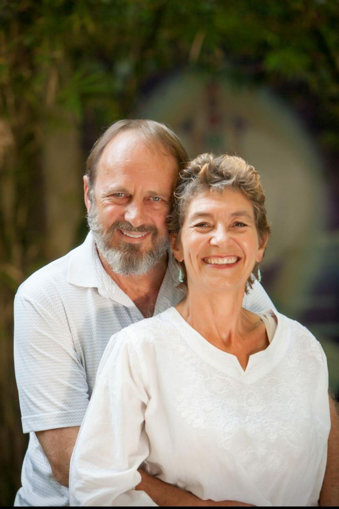

Jean du Plessis is a contemporary spiritual teacher and writer of books and articles in the Wayist tradition. He is also a member of the collective editorial team Salvar Daosenghlu.

Jean and Adele (his soul-mate spouse of many decades) studied, learned, taught and worked in the field of transformative spirituality and spiritual energy healing for more than thirty years. They received seminary and university degrees in World Religions and Christian Theology, through part-time and evening studies. In Johannesburg, South Africa, the couple started and managed (for 10 years) several residential care programs for at-risk women and girls in the slums. During the 1990s, Jean delivered a paper that was published by the 1st International Conference on Child Commercial Sexual Exploitation, in Stockholm, Sweden.

Together, Jean and Adele studied spirituality at ashram level and post-grad level in India, Vietnam and Cambodia, where they ran an internationally renowned spiritual energy clinic and workshops under the name Wayist Spiritual Energy Center ([wayist.com](https://wayist.com)). Today, they work from Canada and Puerto Vallarta, Mexico.

Their combined expertise in life-transforming spirituality and presenting workshops to thousands of people on the Butterfly Path is evident in their books. Visit [theWAY Media](https://wayism.net/authors/jean-prieur-du-plessis/) for the catalogue of published work.

## Write with me

Join the editorial team of writers, editors, and multimedia creators, or join us for workshops. Connect with me on [Wayist.Life](https://wayist.life) (@jeanduplessis) or [X](https://x.com/wayistcoach) (@wayistcoach).

## From a reader

> Butterfly Path is a lifesaver for me because I have been searching for a true Path all my life. I have been through all from Christianity to Buddhism and Yoga and this book is when everything became clear to me. It is no exaggeration to say that this is a moment of enlightenment to me. I hope millions of people can find same CONTENTMENT.
>
> — Andrew Hirch, Ohio
