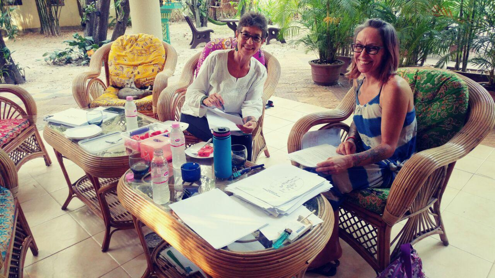

Jean and Adele are Canadians, from Ontario. They teach spirituality, spiritual energy healing and conduct clinics around the world (when they are not writing and editing). They present workshops in Cambodia, Vietnam, India and Thailand on BUTTERFLY PATH. Over the past five years they have trained hundreds of people. In Cambodia, they manage a clinic for spiritual energy healing, for half of the year. The clinic, [Wayist Energy Center (at Angkor Wat)](https://wayist.com) is very busy, and is visited by attendees from 80 countries; many are regulars, many attest to life-transforming experiences ([note the Tripadviser ratings](https://www.tripadvisor.com/Attraction_Review-g297390-d7738998-Reviews-Wayist_Spiritual_Energy_Center-Siem_Reap_Siem_Reap_Province.html)).

The couple had advance bookings for healing retreats and workshop sessions (months in advance) when Covid-19 suddenly started to close down airlines and international borders. Honour bound to attend to clients who insisted on attending because they booked as much as a year before…Jean and Adele finally found themselves stuck in Cambodia, not being able to return home.

They are using their time to edit and prepare books and an energy healing course for publishing.

Then a little miracle happened–Shaunna. The angels brought J&A together with a couple from the USA, Shaunna and Jeremiah, and their daughter Serenity–also stuck in Cambodia. It so happened that Shaunna turned out to be the best editor to ever help fix Jean’s writing (a huge task that only someone of exceptional editing skill can master), and so it happened that Shaunna joined the editorial team.

Life in isolation during this exceptionally interesting period, in Cambodia, turned out to be the best medicine a writer and editors can have to prepare books about transforming spirituality, spiritual energy hygiene, soul healing and mind-fixin.
